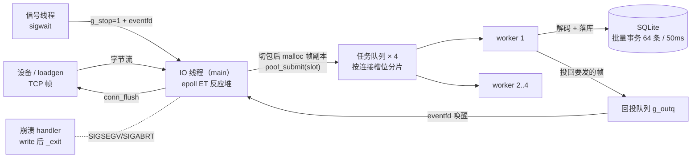

<!-- 由 verify/patch-docs-mvp.py 生成；要手改请先删掉这一行 -->
# 架构：线程模型与数据流（V1.0）

> 一句话：**IO 线程只搬字节和投递，业务在 4 个 worker 里跑；worker 全程不碰 socket，
> 它要发的帧投回队列，由 IO 线程统一发。**
> 每个设计取舍的"为什么"都写在代码注释里（`src/net/epoll_server.c` 顶部与各段小标题）。

## 1. 线程拓扑（6 条线程）



```text
         ┌──────────── IO 线程（main，唯一碰 socket 的线程）────────────┐
设备 ───▶│ epoll_wait(ET) ─▶ recv ─▶ rbuf ─▶ frame_parser_feed(逐字节)  │
         │      ▲                                        │ 凑齐一帧     │
         │      │ eventfd（worker 投递完成）             ▼              │
         │      │                              frame_job（malloc 帧副本）│
         │      │                                        │ pool_submit  │
         │      │                                        ▼              │
         │  drain_outq ─▶ conn_queue ─▶ conn_flush ─▶ send ────────────▶ 设备
         └──────┬───────────────────────────────────────────────────────┘
                │ 4 条环形队列（按连接槽位 % 4 分片，同一连接保序）
                ▼
        worker ×4 ─▶ proto_decode ─▶ printf frame ─▶ store_insert_event_batched
                                                          │
                                                          └▶ g_outq + write(eventfd)
        信号线程 ×1 ─ sigwait(SIGINT/SIGTERM) ─▶ g_stop=1 ─▶ write(eventfd)
```

线程总数 = **1（IO）+ 4（worker）+ 1（信号）= 6**。

## 2. 一次上报的完整旅程（9 步）

1. **accept**：新 fd → `fcntl(O_NONBLOCK)` → `conn_alloc()` 领槽位（`gen += 1`、清 `rbuf/wbuf/parser`）→ `epoll_ctl ADD`（`EPOLLIN|EPOLLET`）。
2. **读**：读循环一直 `recv` 到 `EAGAIN`（ET 不读到 `EAGAIN` 就不再提醒）。
3. **切包**：`rbuf` 里这 m 个字节**逐字节**喂 `frame_parser_feed`；半帧的保管权在 `c->fp` 手里，所以喂完 `rlen` 直接清零。
4. **投递**：凑齐一帧 → `malloc(sizeof(struct frame_job) + flen)`，把帧字节**复制**进去（`rbuf/frame_buf` 下一轮就被覆盖），带上 `slot + gen` → `pool_submit(slot)`。
5. **解码**（worker）：`proto_decode` 失败 → 打 `drop: 解码失败`，**只丢这一帧，连接继续**。
6. **落库**（worker）：`store_insert_event_batched`；`0/-1/-2/-3` 四类结果分开记（数据不合规 / 库忙 / 磁盘满…）。
7. **投回**（worker）：帧进 `g_outq`，写 `eventfd` 把 IO 线程叫醒。
8. **发送**（IO）：`drain_outq` **先取队列再读 eventfd**（反过来会漏唤醒）→ `send_back` 校验 `slot + gen` 还认得这条连接 → `conn_queue` → `conn_flush`。
9. **背压**：`send` 撞 `EAGAIN` → `EPOLL_CTL_MOD` 挂 `EPOLLOUT` → 可写事件回来续发 → 发完**只在真挂着时**才撤（否则空转烧 CPU）。

## 3. 谁读写什么（锁的边界）

| 状态 | 住在哪 | 谁碰 | 要不要锁 |
| --- | --- | --- | --- |
| `conns[1024]` 槽位表、`rbuf/rlen`、`wbuf/wlen/woff/out_on`、`frame_parser` | 全局静态数组 | **只有 IO 线程** | 不需要 —— 这是整个设计的核心收益 |
| 任务队列 × 4（各 65536 格） | `struct pool` | IO 线程 push、worker pop | 每队列一把互斥锁 + 条件变量 |
| `g_outq` 回投队列 | 同上 | worker push、IO 线程 pop | 同上 |
| `g_batch` 批量落库状态 | 全局 | 4 个 worker 都调 | `store_batch_t.mu` |
| `g_stop` | 全局 | 信号线程写、IO 线程读 | `volatile sig_atomic_t`（可见 + 原子，不要替代锁去保护结构体） |
| `g_db`（sqlite3*） | 全局 | 4 个 worker | 不用 —— sqlite3 默认 serialized 模式，多线程共享安全 |

**为什么 worker 不直接 send**：`wbuf` 只被 IO 线程碰 ⇒ 写缓冲不需要锁；
worker 再多也不会两个人同时改同一条连接的缓冲。代价是多一次内存投递 + eventfd 唤醒。

## 4. 四条旁路

**① 信号线程（不是 handler）**：`SIGINT` 是进程级信号，内核投给任意一个没屏蔽它的线程。
落到 worker 上时 handler 跑了、`g_stop` 也置了，但 IO 线程还堵在 `epoll_wait` —— 主循环永远退不出来
（实测：连跑 3 次收尾全挂，`/proc/<pid>/task/*/wchan` 显示主线程 `do_epoll_wait`、4 个 worker `futex_do_wait`）。
现在：任何 `pthread_create` **之前** `pthread_sigmask(SIG_BLOCK, {SIGINT,SIGTERM})`，一条线程 `sigwait` → 写 eventfd → IO 线程必然被叫醒。

**② 崩溃现场**：启动期就 `open` 崩溃日志 fd（`O_APPEND|O_CLOEXEC`），`crash_install` 对
`SIGSEGV/SIGABRT/SIGBUS/SIGFPE/SIGILL` 装 `SA_SIGINFO|SA_RESETHAND`。handler 里**只调 async-signal-safe 的
`write`/`_exit`**（`snprintf`/`malloc` 都不能用），记 pid/tid/signal/si_code/si_addr + `backtrace`。
保留 PIE/ASLR：启动期 `dladdr` 存 `base`，事后「地址 − base → `addr2line`」还原 `文件:行号`。

**③ 批量落库**：见 README 的压测摘要 —— 逐帧事务 = 每帧一次 fsync，是 38.6% 错误率的真凶。
现在 64 条或 50ms 提交一次，进程退出前 `store_batch_flush` 兜住最后一批。

**④ 写缓冲 → EPOLLOUT**：`conn_queue` 只在 `wbuf` 装得下一整帧时才拷（装不下 → 整帧丢弃，绝不写半个帧）；
`conn_flush` 每发出去多少就前进 `woff` 多少。

## 5. 关闭顺序

```text
信号线程 sigwait ─▶ g_stop=1 + write(eventfd)
                 ─▶ IO 线程 epoll_wait 醒来 → if (g_stop) break
                 ─▶ store_batch_flush（提交最后一批）
                 ─▶ close(g_efd) → close(listen_fd) → close(epfd) → return 0
```
**没有** join worker、没有 `pool_stop`：V1 靠进程退出带走 worker（`taskq_stop` + `join` 已在 `src/pool` 里
用 `test_pool` 验过，网关这层没接 —— 属 V2 的收尾细化）。

## 6. 规格 A#8 的 5 条判据落在哪

| 判据 | 证据 |
| --- | --- |
| 一条命令构建跑通 | `make`（10 个目标，`-Wshadow` 零警告） |
| 半包 / 粘包实测：一次 recv 恰好 2.5 个包 → 输出 2 个完整包 | `loadgen -m sticky`：每轮 send = 残料 + 2 整帧 + 第 3 帧只带一半，首轮 250ms 窗口内服务端只吐 2 帧 |
| 架构图 | 本文第 1 节 |
| 能脱稿讲线程模型 | 第 3 节「为什么 worker 不直接 send」 |
| 一组压测数据 | README 的压测摘要表 |